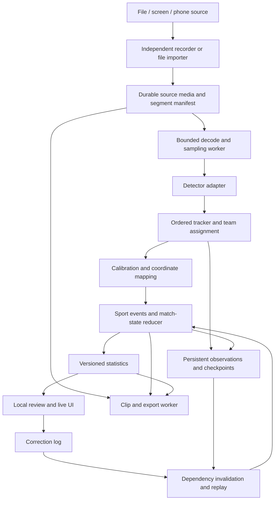

# MatchLens — product and engineering plan

Status: historical September 29 planning proposal. The engineering beta now exists; see `docs/STATUS.md` and `docs/COMPLETION_ROADMAP.md` for current scope and evidence.

Prepared September 29, 2026. All performance and accuracy thresholds below are proposed acceptance targets, not measured results. No models, dependencies, benchmark media, or application code were installed or created during planning.

## 1. Recommendation and environment

Build MatchLens as a local application with a browser interface, a Python application service, isolated video/analysis workers, and durable files on disk. Start with assisted review of one soccer recording. Make recording reliability, timestamp correctness, corrections, and reproducible evaluation first-class features before expanding automatic event detection.

The key architectural rule is: **recording must never wait for inference**. The key product rule is: **unknown observations remain unknown**. A convincing dashboard is not evidence that possession, player identities, or goals are correct.

### Verified development environment

| Item | Observed | Planning implication |
|---|---|---|
| Computer | Apple M2 Pro MacBook Pro; 12 CPU cores, 19 GPU cores, 16 GB unified memory | Start with one compact inference worker. CPU and GPU share a constrained memory budget. |
| OS | macOS 27.0.1, arm64 | macOS is the first tested platform; keep platform-specific capture behind adapters. |
| Available disk | Approximately 127 GiB at inspection | Estimate recording size before capture; make storage usage visible. |
| Python | Default `python3` is 3.14.7 | Select a separate, pinned project interpreter after a dependency compatibility check; propose Python 3.12 as the initial compatibility candidate. Do not replace the system interpreter. |
| JavaScript | Node 22.13.1, npm 10.9.2 | Verify the selected frontend toolchain's supported Node range and pin a compatible version. |
| Video | FFmpeg/ffprobe 9.0.2; VideoToolbox acceleration; AVFoundation input; H.264/HEVC encoders | Existing tools support a media feasibility spike. Actual capture permissions, codecs, and throughput remain untested. |
| Stream protocols | RTMP/TCP/UDP present; SRT was not listed | Do not assume the installed FFmpeg supports SRT. `srtp` is a different protocol. |
| Build tools | Git and Apple Clang available; CMake, Docker, and uv not found on PATH | None is a prerequisite for planning or the initial product. Add tools only when required. |
| Python libraries | Torch, torchvision, OpenCV, ONNX Runtime, FastAPI, NumPy, SciPy, PyAV, and PySide6 not importable in the default interpreter | This is not yet a configured ML environment; other virtual environments were not exhaustively searched. |
| Workspace | No existing MatchLens folder or applicable ancestor `AGENTS.md` found; workspace root is not a Git checkout | The only new artifact is this plan. Initialize the proposed repository only after review. |

The current development folder is inside iCloud Drive. Runtime match data should instead default to `/Users/pratick/Library/Application Support/MatchLens/`, or a user-selected nonsynced local drive. Do not put recordings, databases, caches, or private benchmark footage into this repository. Operating-system backups and user-selected synced locations remain outside the application's control.

At 8–12 Mb/s, a 90-minute video uses approximately 5.4–8.1 GB before audio, proxies, and exports. This is bitrate arithmetic, not a promised recording size. Preflight against measured/source bitrate, expected duration, and a safety reserve; never silently delete recordings to free space.

### Assumptions for review

- One developer; one camera and one active analysis job initially; no dedicated GPU or paid services.
- V1 targets real soccer footage with sustained wide views. A screen recording of such footage is another file input.
- A rendered soccer video game is a separate visual domain. Supporting its ingestion does not establish model accuracy. Choose one game, camera preset, and HUD profile before claiming game-video analysis support.
- A sideline phone should be stable, landscape, and preferably elevated. A low phone beside the touchline can have severe occlusion and cannot guarantee whole-field analytics.
- Users can review proposals and correct results. Fully automatic officiating, complete ball trajectories, and exact full-match player identities are not initial promises.

## 2. Product specification

### Product purpose and workflows

MatchLens helps a coach, player, or analyst turn local video into a reviewable record of a match: searchable events, track overlays, supported statistics, and useful clips. Soccer is the first sport module. Capture, storage, corrections, jobs, and exports are shared infrastructure.

The post-game workflow is: create match → import recording → choose source profile and teams → analyze → review suggested events/tracks → correct → generate report/highlights → export or delete.

The live workflow is: check camera/network/storage → pair source → start recording → analyze behind the recording → display delayed results and warnings → finish recording → run a more thorough offline pass → review and export.

### Capability scope

| Capability | V1: assisted file review | V2: stationary physical games | V3: live capture | Later |
|---|---|---|---|---|
| Prerecorded video, including screen-recorded files | Required | Retained | Retained | More formats/profiles |
| In-app desktop recording while analyzing | V1.1 follow-up | Supported through capture adapter | Same recording contract as phone | Additional OS adapters |
| Player detection and anonymous tracks | Required on declared source profile | Physical-game evaluation | Delayed tracks | Better re-identification |
| Teams and officials | Suggested shirt-color groups; manual labels; unknown allowed | Better temporal classification; goalkeeper/referee overrides | Same with reliability warnings | Specialized models |
| Ball, goals, field geometry | Ball observations experimental; manual event tags | Ball evaluation; manual goal/field annotation; calibrated geometry | Only validated capabilities enabled | Trained specialists and automatic calibration |
| Events and highlights | Manual events plus independently validated suggestions; automatic clips around marked events | Validated soccer event rules | Provisional live events | Better learned event detection |
| Top-down field, heatmaps, paths | Deferred unless source already has valid calibration | Required for calibrated visible regions | Timestamp-aligned delayed view | Dynamic/multi-camera calibration |
| Corrections | Event add/edit/reject, team/identity assignment | Track split/merge, point edits, calibration edits, undo | Same after/during capture as supported | Faster assisted editing |
| Statistics | Confirmed event counts, reviewed score, observed-track duration, coverage | Validated spatial and ball-dependent statistics | Available subset with delay/coverage | Historical comparisons |
| Reports and export | Local HTML, print-to-PDF, JSON/CSV, clips/reel MP4 | Spatial report and annotated video | Finalize after offline pass | Player/team libraries and sharing integrations |

Capturing input is a broader promise than interpreting every input accurately. The UI must show the tested source profile and unsupported capabilities before analysis.

### Live interface

Show the incoming preview, recording duration/bytes/free space, independent recording and analysis states, current score and period clock, recent events, basic statistics, and the top-down field when calibration is valid.

Provide two explicit views: an incoming preview and a delayed analysis view. Draw tracks and field positions against the analyzed frame's timestamp. Never put old positions over the current incoming frame. If the UI shows both views, show each timestamp and the measured delay.

The score is based on user-confirmed goals or manual entry; proposed goals are visually separate. The clock has period, kickoff anchor, pauses/offsets, and stoppage-time representation. Video elapsed time is not automatically the match clock. Scoreboard OCR is optional supporting evidence, not an authoritative input.

Warnings must be actionable: poor illumination/blur, small visible players/ball, limited field coverage, calibration invalidated by movement, connection loss, recording gap, low disk space, thermal/processing slowdown, and stale analysis. Each warning states which statistics are affected. Color is supplemented by text; timeline and editing actions have keyboard controls.

### Post-game interface

Use a full recording player with synchronized overlays, event markers, per-player track inspection, review filters, and clip in/out controls. Track selectors distinguish anonymous track IDs from roster identities. A player reel requires reviewed identity links; uncertain links are excluded by default.

Reports contain match metadata, reviewed score/events, supported statistics, coverage/reliability notes, charts, highlight links, source/run revisions, and an explanation of missing metrics. V2 adds heatmaps, paths, shot maps, and pass maps where their prerequisites pass validation. Historical comparisons later require compatible sport rules, metric versions, period definitions, and comparable coverage; incompatible runs must be labeled or reprocessed.

### Reliability model

Store and display three distinct concepts:

1. **Review status:** proposed, confirmed by user, rejected, or superseded.
2. **Evidence quality:** detection/association/calibration uncertainty and reasons for abstaining.
3. **Coverage:** the amount of relevant match time or field area actually observed and analyzed.

Every statistic carries value/unit, time scope, denominator, usable coverage, method version, analysis revision, and reliability status. For example, possession is a share of observable in-play time under a documented control definition; unknown intervals are shown separately. Do not normalize unknown time away and present the result as full-match possession.

Do not label a detector score “87% accurate.” Show raw scores only in technical detail until reliability has been calibrated on held-out data. Use estimated/confirmed/unavailable labels and reason codes. Statistical intervals should be calculated only when the evaluation method supports them. Confirming a visible event does not certify that every event in the match was found.

### Privacy, cost, and deletion

No account, paid API, mandatory cloud storage, analytics service, or subscription is needed. Bundle frontend assets/fonts locally. Permit explicit initial model downloads or offline model import; once installed, ordinary workflows work with external networking blocked. Updates and diagnostic exports are opt-in. Reports are generated from local templates; an LLM is unnecessary.

Bind the application API to loopback by default. Use a per-launch local session token, origin checks, and strict file-path validation. Live pairing opens only the selected LAN ingest endpoint, protected by an expiring pairing secret and encrypted transport; it does not expose the full application API. Disable public relays, internet discovery, and automatic port forwarding by default.

Delete-match first stops jobs and capture, then removes the managed source copy, segments, database/sidecars, detections, thumbnails, proxies, clips, reports, cached identity features, and match-specific logs. A small deletion journal lets cleanup finish after interruption without retaining match content. Shared model weights remain. The global library index removes the match entry.

The application can completely remove its managed match data. It cannot promise forensic erasure on SSDs or delete copies in OS backups, the user's original import location, or previously shared/exported destinations. Show these boundaries and any known external exports in the delete dialog. Never delete an external source file merely because its managed import is deleted.

## 3. Proposed architecture

Use a modular monolith for application/domain logic, with process isolation for recording and expensive work. Clear interfaces do not require a network microservice for every stage. Use a local supervisor and persisted job queue; Redis, Kafka, Kubernetes, and a cloud control plane are unnecessary.



### Component contracts

All domain messages include schema version, match/source/run IDs, sequence information, and media time. Model adapters return plain typed data; downstream code must not depend on framework-specific tensors.

| Component | Responsibility and output contract |
|---|---|
| Source adapter | File, desktop, camera, or stream metadata; codec/timebase; connection state; discontinuities. |
| Recorder/importer | Own source preservation. Publish `SegmentCommitted` only after media is closed, checked, and durably committed; imported originals get a checksum and media index. |
| Decoder/sampler | Emit `FrameRef` with source PTS/timebase, normalized media time, dimensions, rotation/transform, and a bounded buffer reference. Report intentional sampling separately from decode failure. |
| Detector | `infer(batch) -> DetectionBatch`: class, box/mask/keypoints as available, score, model ID, frame reference. |
| Tracker | `update(observations, dt) -> TrackObservations`; `checkpoint/restore`. Identity scope is source, camera shot, and run, with explicit association uncertainty. |
| Team/role assignment | Time-ranged team/role hypotheses; explicit unknown; separate goalkeeper and official handling. |
| Calibration | `project(point, timestamp) -> position + validity/uncertainty`; calibration version, field dimensions, visible region. |
| Sport event engine | Temporal observations → proposed `EventRecord` with interval, participants, evidence references, and prerequisites. |
| Match-state reducer | Events and manual clock/score updates → period, score, possession segments, and state snapshot. |
| Statistics engine | Pure calculations over an explicit run/revision and time interval → `MetricRecord` with coverage and provenance. |
| Correction service | Validated commands, audit history, undo/redo, affected dependency ranges, and new revision. |
| Clip/export worker | Source time intervals + selected revision → clips/reports/data; atomic completion and manifest. |
| Job supervisor | Durable job states, leases, retries, cancellation, resource budget, dependency DAG, progress/health. |
| Evaluation runner | Frozen media + annotations + pipeline config → accuracy/performance report and artifacts. |

### Recording, buffering, and backpressure

For imported files, copy the original into the managed match directory and checksum it; an explicit reference-only option can follow later. Decode or proxy failures must not modify the source.

For capture, use a dedicated recorder process to write short, independently usable segments, initially targeting about 2 seconds, with actual boundaries recorded in the manifest. Prefer copying compatible incoming encoded packets; encode raw desktop/camera input once. Prototype fragmented MP4 or Matroska with the actual source codecs and crash tests before choosing the capture container. FFmpeg segmentation follows keyframes, so configured duration alone does not guarantee an exact boundary. [FFmpeg segment documentation](https://ffmpeg.org/ffmpeg-formats.html#segment_002c-stream_005fsegment_002c-ssegment)

Analysis discovers finalized segments from disk. It has no blocking queue into the recorder. The recorder's file manifest/journal remains usable even if the application database or analysis service is unavailable. Recording completion should not require a successful inference result or an available UI.

Start with one decode worker, one inference worker, ordered per-source tracking, and one low-priority export worker. Decode into bounded buffers, initially 4–8 sampled frames, with limits expressed in both bytes and count. Pass frame references/shared buffers between processes rather than repeatedly serializing full images. At 1080p, eight uncompressed RGB frames alone occupy about 50 MB; tensors and model memory are additional.

Use different scheduling policies:

- **Offline:** backpressure pauses decoding until capacity is available; process every frame requested by the selected analysis profile. Seek from keyframes and preserve presentation timestamps.
- **Live:** maintain a small latest-work queue. If delay exceeds budget, reduce sampling, drop stale analysis work, and record the skipped time ranges. Keep tracking ordered and update motion models using elapsed time, not an assumed constant frame interval.
- **After capture:** enqueue a complete offline pass from preserved media to repair live analysis gaps. Keep live and final runs distinct; never silently replace a reviewed run.

Try 10 analysis samples per media second initially, falling back to 5 then 2 only with a capability change. At low cadence, disable short-event/pass claims before lowering the bar for evidence. Disable expensive overlays and defer exports next; pause analysis entirely if necessary. Under ordinary load, target 5–10 seconds of displayed live delay. If it cannot hold the budget, say so and enter recording-only mode.

Recorder priority is above decode/inference, which is above export. Bound CPU threads, number of concurrent GPU models, disk writes, and total resident memory. Process separation alone does not protect against shared resource exhaustion.

An inference crash must preserve all committed recording segments and allow capture to continue. A recorder or power failure may damage the current unfinished segment; test and state the actual loss window. A disconnected phone cannot deliver missing frames to the computer: record a gap, reconnect as a new source epoch, and optionally reconcile with a separately recorded phone original. Continuous coverage across network loss requires a tested source-side backup path; it is not implied by receiver buffering.

### Time and identity

Preserve source PTS and rational timebase. Maintain a canonical media timeline in integer microseconds, plus a mapping to segments/epochs. Store wall-clock/monotonic receipt times separately. Track variable frame rate, rotation, dropped packets, timestamp resets, pauses, and reconnects explicitly; do not derive time from `frame_index / nominal_fps`.

Match time is a separate period-and-anchor mapping. Broadcast replays, camera cuts, slow motion, and non-play segments are labeled. Reset or suspend track association at cuts and exclude replays from event counting. V1 may rely on manual replay exclusion; unattended broadcast event counting remains disabled until this is reliable.

An anonymous `track_id` is not a person's identity. Use time-ranged links between track fragments and optional `player_id` roster entries. Missing/occluded people remain unobserved; appearance similarity cannot establish a certain identity. Preserve fragmentation and confidence instead of inventing complete trajectories.

### Soccer perception and events

Begin with pretrained person detection, a ByteTrack-style tracker, pitch-region filtering, and temporally smoothed shirt-color grouping. Officials, goalkeepers, spectators, similar kits, and changing lighting require separate role labels and manual overrides. Ball detection should have its own adapter, search resolution, temporal logic, and evaluation; a generic sports-ball class is only a baseline.

In V2, let users label at least four well-spread noncollinear pitch correspondences, preferably more, and draw goal mouths/visible boundaries. Fit and inspect the homography; validate using separate landmarks. Store actual or explicitly assumed field dimensions. Map player ground-contact estimates, not head/box centers. Recalibrate when the camera moves or zooms. Elevated balls do not lie on the ground plane; a homography cannot recover their true 3D location or prove a goal-line crossing.

Normalize sport coordinates but retain metric dimensions when known. Interpolate only over short, bounded, validated gaps; do not extrapolate heatmaps or distance across invisible field regions. Suppress speed/distance when localization uncertainty, jitter, or sampling makes them unreliable.

| Event | Initial evidence model | Required restraint |
|---|---|---|
| Possession interval | Stable control hypothesis from ball proximity, relative motion, and persistence | Nearest player alone is insufficient. Allow contested, dead-ball, and unknown states. |
| Pass | Controlled release, ball transit, subsequent teammate control | Require visible/credible transitions; distinguish pass attempt, completion, and unclassified ball movement. |
| Turnover | Stable control changes between teams during play | Exclude stoppages and ambiguous loose-ball periods. |
| Shot | Ball movement toward annotated goal plus contextual evidence | Crosses/clearances can look similar; proposed until validated/reviewed. |
| Save | Shot candidate followed by goalkeeper intervention and a supported outcome | A nearby goalkeeper or deflection alone does not establish a save. |
| Goal | Corroborated goal-area sequence and/or scoreboard/clock evidence | Projected ball position alone cannot establish a legal goal. Keep score confirmation separate. |

Define these labels in an annotation handbook before training or measuring them. Include own goals, penalties, rebounds, deflections, and period boundaries in later event semantics. Never make the full product depend on all six detectors being solved simultaneously.

### Corrections, recomputation, and persistence

Use SQLite for the library index and a separate match database for match metadata, tracks/identity links, events, revisions, jobs, and metrics. Start with chunked, indexed observation tables; add Parquet for immutable bulk observations only if benchmarks justify it. Keep media and generated files out of SQL blobs. Route writes through a serialized writer with short transactions; WAL permits reader/writer concurrency but still only one writer at a time. [SQLite WAL documentation](https://sqlite.org/wal.html)

Record raw model observations immutably. Corrections are an append-only command log over a revision: assign team/person for an interval, split/merge fragments, override a point, correct calibration, add/edit/reject an event, change period anchors. Undo/redo appends compensating commands. Reject impossible identity merges and overlapping contradictory assignments unless the user resolves them explicitly.

Dependency examples:

- Identity edit → participant attribution, per-player statistics, relevant reels; detector outputs remain reusable.
- Team edit → possession/pass interpretation, event attribution, team/player totals, report/reels.
- Track-position edit → coordinates, movement/possession/events in the affected temporal dependency range.
- Calibration edit → affected field coordinates, spatial events, heatmaps, speed/distance and downstream statistics.
- Event rejection → match state, counts, associated clip membership, reports and historical summaries.

Temporal effects can extend beyond the edited frame. Recompute from the nearest valid predecessor state until downstream state converges; fall back to the remainder of the period or full match when necessary. Do not assume a fixed five-second window handles every correction.

Publish derived results atomically under a new revision. Mark older views/exports stale while recomputation runs. Exports pin one revision so a report cannot combine old totals with new events. Compare incremental recomputation with a full replay in tests.

Each job records input hashes, model/config/code/schema versions, upstream revisions, completed chunks, and a checkpoint. Stateful checkpoints include tracker motion/filter state, next ID, team classifier state, calibration version, and event/reducer state. An adapter unable to serialize state must replay from a defined reset boundary; arbitrary mid-shot restart is not equivalent.

Use at-least-once execution with idempotent chunk commits, leases/heartbeats, overlap context, and deterministic ownership of boundary outputs. Temporary outputs become visible only after atomic commit. Resume the first incomplete chunk; invalidate downstream checkpoints when inputs or corrections change. Distinguish capture states from analysis states: analysis failure must not turn a healthy recording indicator red.

### Clips, reports, and exports

Creating an event schedules a clip request, initially 10 seconds before and 5 after the event, configurable by event type. Live clip jobs wait until post-roll is durably available. Clamp to source boundaries and mark missing media; never disguise a gap by shifting the event time.

Offer a fast keyframe-aligned copy and an exact-boundary re-encode. Normalize codecs, resolution, audio, and timestamps for highlight reels. Merge overlapping intervals without double-counting their events. Exact exports use original media; overlays use the pinned analysis revision and matching timestamps.

Export MP4 clips/reels and optional annotated recording; a self-contained HTML report with local assets and print-to-PDF; JSON with schemas, provenance, intervals and unknown values; CSV tables with explicit units. Store an export manifest and verify duration, decodability, timestamps, audio sync, and revision. Sharing is an explicit export action; hosted sharing is a later, separately configured feature.

### Additional sports and cameras

A `SportPlugin` supplies field geometry, roles, period/scoring rules, supported events, annotation vocabulary, feature prerequisites, statistics definitions, and rendering configuration. Detectors are selected by source/sport profile. Keep soccer rules out of capture, jobs, storage, and generic correction commands. Validate this boundary with a small test-only alternative rule set before implementing a second sport.

Multi-camera is a later project: independent recordings and calibration, explicit clock offsets/drift, cross-view association uncertainty, fusion, and event deduplication. Include `source_id` now but do not build distributed coordination or universal identity matching in V1.

## 4. Technology selection

| Area | Proposed choice | Why and decision gate |
|---|---|---|
| Application/domain | Python, typed schemas with Pydantic, FastAPI, local REST + WebSocket updates | Suits ML experimentation and clear domain contracts. Keep heavy work outside request handlers. |
| UI | React + TypeScript + Vite; HTML video; Canvas/SVG overlays and field | Suitable for timeline editing and shared post-game/live UI. Build assets once and serve locally. No frontend CDN. |
| Desktop distribution | Local launcher + browser initially | Avoid a second native runtime before media/correction UX stabilizes. Evaluate a desktop shell only when packaging needs justify it. |
| Video | FFmpeg/ffprobe subprocesses; PyAV for timestamp-aware frame access | Mature media handling; separate recording/export from inference. Verify PyAV/FFmpeg build compatibility instead of assuming the CLI and Python package share libraries. |
| Geometry | OpenCV + NumPy/SciPy | Calibration, robust fitting, coordinate math, image preprocessing. Do not use OpenCV capture as the authoritative recorder/timebase. |
| Detector baseline | YOLOX tiny/s, evaluated behind `Detector` | Upstream provides pretrained models and ONNX export under an Apache-2.0 code license. Treat it as a replaceable baseline, not a claim of soccer-ball performance. Check each weight artifact separately. [YOLOX upstream](https://github.com/Megvii-BaseDetection/YOLOX) |
| Inference runtime | ONNX Runtime CPU baseline; benchmark CoreML on this Mac | One portable inference interface. Confirm provider availability, graph partitioning, numeric parity, and actual speed; fallback may negate acceleration. [CoreML provider documentation](https://onnxruntime.ai/docs/execution-providers/CoreML-ExecutionProvider.html) |
| Model experiments/training | PyTorch, optional MPS | Use only when needed for model work; MPS is an available backend, not a local performance guarantee. [PyTorch MPS documentation](https://docs.pytorch.org/docs/stable/notes/mps.html) |
| Tracking | ByteTrack association baseline behind a local adapter | MIT-licensed reference and a useful starting point for track-by-detection. Add camera motion compensation/re-identification only after measuring failure modes. [ByteTrack upstream](https://github.com/FoundationVision/ByteTrack) |
| Storage/jobs | SQLite + managed files; explicit local worker supervisor | Durable and inspectable without external services. Add migrations, leases, recovery, and backups from the beginning. |
| Phone streaming, V3 | MediaMTX on the computer + LAN WebRTC/WHIP publishing page | Reuse transport; develop pairing, recording, health, and UX around it. Browser codec support must be tested. [MediaMTX browser publishing](https://mediamtx.org/docs/publish/web-browsers) |
| Reports | Local HTML templates; browser print-to-PDF; chart images/data | Reproducible and shareable without an AI service. Add automated PDF rendering only if manual printing proves insufficient. |
| Quality tooling | pytest, property tests for reducers/time mappings, Playwright, TrackEval, local performance logs | Tests cover both pipeline behavior and reviewer workflows; tracking evaluation uses an established reference. [TrackEval](https://github.com/JonathonLuiten/TrackEval) |
| Native optimization | C++ with pybind11, only after profiling | Preserve adapters. First eliminate unnecessary copies, decoding, contention, and redundant inference. |

Do not pin exact dependency versions in this plan: Phase 0 selects a mutually compatible set and commits locks. Audit code, weights, training data, and redistribution terms separately in a model/dependency registry with checksums and attribution. Public availability does not itself establish unrestricted product use.

The installed FFmpeg enables GPL components. A distributed bundle needs a deliberate build/license choice and the corresponding notices/source obligations; “FFmpeg is free” does not settle redistribution. [FFmpeg licensing guidance](https://ffmpeg.org/legal.html)

Phone browser publishing requires camera permission and a secure context. A plain LAN HTTP URL is not the phone's localhost. Plan local HTTPS with a device-trusted certificate and a documented pairing/setup flow, or evaluate a free native sender if that flow is unacceptable. Do not assume foreground publishing survives phone lock, calls, or browser suspension. [Browser camera requirements](https://developer.mozilla.org/en-US/docs/Web/API/MediaDevices/getUserMedia)

Profile end-to-end stages before native work. A C++ rewrite is justified only when a measured Python hotspot materially limits the target after simpler changes, and the replacement passes output-parity benchmarks. It will not repair bad observations or a fundamentally unsuitable model.

## 5. Phased implementation plan

Estimates are focused engineering hours for one developer, including basic annotation, tests, and integration; they assume access to representative footage and exclude large model-training campaigns. Re-estimate after Phase 0. Gates, not dates, determine readiness.

| Phase | Deliverables in order | Exit gate | Estimate |
|---|---|---|---|
| 0 — feasibility and foundations | Obtain permitted sample footage; define source profile and annotation rules; compatibility/model/runtime benchmark; source/PTS schema; media and crash spikes; dependency decisions | A reproducible baseline report, usable sample corpus, tested decoding path, honest capability limits, and locked implementation choices | 30–50 h |
| 1 — assisted file MVP | Managed import → resumable analysis → player tracks → review timeline → event/identity labels → metrics → clips/report/export → packaged local launch | MVP acceptance contract below passes on held-out videos and one full match | 140–220 h |
| 1.1 — desktop capture | macOS permission/source selection, independent segmented recorder, analysis of completed segments, minimal recording health UI | Kill analysis during capture; source recording remains complete; screen source profile documented | Budget within V3 capture work below, or schedule immediately after V1 |
| 2 — stationary-phone analysis | Phone-file formats/rotation/VFR; calibration wizard; team/role correction; track split/merge/point edits; heatmaps/paths; ball/event prototypes; dependency recomputation | Calibration/tracking targets pass on declared conditions; edited results equal full recomputation; uncertain event types remain disabled | 100–170 h |
| 3 — live phone and dashboard | Phone/codec/HTTPS spike → pairing/transport → durable receiver recording → reconnect/gaps → adaptive analysis → synchronized dashboard → offline final pass | Two-hour soak and fault tests; latency/memory budget met or recording-only fallback works; tested phone/browser matrix published | 120–200 h, including V1.1 |
| 4 — deeper analysis | Improve ball/events; jersey-assisted identity; player/team reels; metric-versioned historical comparison | Each new capability passes held-out accuracy gates; comparison compatibility enforced | 80–180 h per substantial capability |
| 5 — expansion | Multi-camera synchronization/fusion, then a second sport with its own data and evaluation | Measured cross-view performance; shared core needs no sport-specific rewrite | Separate estimates after discovery |

V1 including Phase 0 is approximately 170–270 hours: 11–18 weeks at 15 focused hours/week. Through V3, the baseline is 390–640 hours: 26–43 weeks at that pace. Allow 25–35% contingency for data collection, packaging, and model integration. This is a substantial part-time project; broad, reliable event recognition can exceed the infrastructure schedule.

The first approved development increment should be one vertical slice: import a ten-minute file, preserve its checksum, analyze selected frames, display anonymous tracks, add one confirmed event, export its clip, interrupt/restart analysis, and demonstrate identical committed results. Expand from that working slice.

## 6. Initial MVP acceptance contract

V1 succeeds if someone can use it to review a real soccer recording and produce a trustworthy, useful summary without editing code.

Required:

1. Import one supported local recording, including a screen-recorded file, preserve an unchanged managed original, and show metadata/storage usage.
2. Run resumable player detection/tracking with progress and declared sampling cadence. Let the user inspect anonymous tracks, assign team/player labels, and mark excluded camera shots/replays.
3. Maintain a timestamped timeline with manual add/edit/reject/confirm. Any automated event proposals must pass their own evaluation gate; no goal/pass detector is required to make the first release useful.
4. Show confirmed event totals by team, a reviewed score when goals are tagged, observed duration per reviewed track/person, and analysis coverage. Describe event counts as counts in the reviewed/tagged set, not complete-match counts unless review is complete.
5. Automatically create clips around selected timeline events; provide custom trims and a team highlight reel from reviewed tags.
6. Produce a report and JSON/CSV export carrying reliability, coverage, and revision; export playable MP4 clips.
7. Preserve corrections through restart, support undo for supported edits, and recalculate affected totals. Full geometric track editing follows in V2.
8. Work without login or external networking after assets are installed; delete all managed match data.
9. Pass the reliability/accuracy gates for the declared V1 profile; document unsupported cases and complete a full-match processing test.

V1 does not claim whole-match possession, automatic accurate goals/shots/passes/saves, exact distance/speed, continuous identities through camera cuts, field mapping without calibration, live phone support, or general video-game recognition. These remain explicit later capabilities, not hidden incomplete MVP features.

## 7. Principal risks and mitigations

| Risk | Likely consequence | Mitigation / release decision |
|---|---|---|
| Small, blurred, occluded ball | Convincing but false possession/passes/shots | Separate ball benchmark, crop/high-resolution experiments, temporal evidence, abstention; keep ball-dependent metrics off until qualified. |
| Similar uniforms and player crossings | Identity switches and misleading player reports | Temporal team hypotheses, short track scopes, reviewable links, split/merge tools; measure identity stability separately from detection. |
| Low sideline angle or partial view | Missing people/ball and biased statistics | Capture guidance, visible-region mask, coverage denominator, no whole-field claims. |
| Camera motion and wide-angle distortion | Wrong field positions and inflated distance | Distortion-aware calibration where necessary, movement detection, invalidation, multiple calibration intervals. |
| Broadcast cuts/replays or virtual-game domain shift | Duplicated events or failed detector | Source profiles, cut segmentation, replay exclusion, domain-specific benchmarks and models. |
| Ambiguous sport semantics | Internally consistent but wrong event counts | Annotation handbook, evidence links, per-class gates, reviewer confirmation, explicit unknowns. |
| M2 memory/thermal limits | Delay, swap, process termination | One model worker, memory/thread caps, sampled analysis, priority recording, deferred exports, soak tests. |
| Phone sleep, codec mismatch, Wi-Fi loss | Recording gaps or no stream | Early device spike, foreground/charging guidance, explicit gaps, reconnect epochs, optional tested phone backup reconciliation. |
| Timestamp/reset errors | Wrong clips and misaligned overlays | Canonical PTS mapping, epoch boundaries, VFR tests, visible timing diagnostics, exact export verification. |
| Incomplete correction invalidation | Stale reports or changed score after restart | Dependency revisions, atomic publication, full-replay equivalence tests, pinned exports. |
| Storage full/corrupt or power loss | Lost current media/job output | Preflight reserve, early warning, durable segments/checkpoints, validated recovery; do not promise survival beyond filesystem guarantees. |
| Restricted data/weights or old research dependencies | Cannot distribute or reproduce the product | Artifact/license registry, compatible locks, replaceable adapters, own permitted footage as the default benchmark. |
| Accidental cloud sync/exposure | Violates local-first expectations | Nonsynced data root, loopback service, narrowly scoped LAN ingest, offline/network tests, explicit exports. |
| Excess scope | Months of infrastructure without usable review | Ship the vertical slice, assisted MVP, and per-capability gates; delay native rewrites, second sport, and multi-camera fusion. |

## 8. Testing and evaluation plan

### Repeatable benchmark corpus

No benchmark videos or annotations were supplied or found for MatchLens. The table below is a corpus acquisition/creation specification, not a claim that these fixtures exist or have measured outcomes. Acquiring and annotating them is a Phase 0 deliverable. Never fill unknown real-match event counts with invented expected results.

Store each asset's ID, SHA-256, source/permission, duration, codec, resolution, timebase, rotation, capture conditions, split, annotation revision, and exclusion/visibility masks. Keep private videos outside Git; version manifests, annotation schemas, and redistributable labels. Freeze evaluation configs and seeds. Split by match/venue/camera/session, not adjacent frames, to prevent leakage.

| Fixture | Planned contents | Expected result / ground-truth requirement |
|---|---|---|
| `media-clock-01` | Generated 60-second, 30 fps video with burned-in frame/time labels and audio sync markers | Exactly 1,800 input frames; correct timestamp mapping; requested exact clip `[10,20)` lasts 10 seconds within one output frame. Tests media plumbing, not model accuracy. |
| `rules-01` | Scripted 20-second observation/event fixture defined below | Exact counts, time denominators, and score; replay/undo restore totals. This is a rule fixture, not a real-video benchmark. |
| `wide-day-01..03` | At least three independently captured or permitted ten-minute wide-view soccer clips | Annotated boxes/tracks/team/visibility; at least one held-out session. Real counts and thresholds linked in the frozen expectation manifest. |
| `broadcast-cuts-01` | A permitted clip with camera cuts, replay, close-up, and return to play | Annotations mark each transition; no identity continuity assumed across cuts; replay events excluded from canonical counts. |
| `phone-static-01..03` | Stationary phone clips at different angles/distances, including VFR/rotation | Independently marked calibration landmarks and tracks; declared visible field coverage. |
| `hard-conditions-01` | Low light, motion blur, camera movement, similar kits, partial pitch | Reliability warnings/abstention; no invalid metric presented as complete. Report accuracy by condition. |
| `screen-01` | Screen capture of permitted real soccer footage with resized player/HUD borders | Correct crop and timestamps; compare with underlying footage where available. |
| `virtual-game-01` | Optional recording of one chosen game/camera preset | Separate annotation/model report; never pooled with real soccer scores. |
| `stream-fault-01` | Replay known media through local ingest with deterministic disconnects, jitter, and timestamp reset | All durably received media preserved; expected gap/epoch records; recovery without duplicate events. |
| `corrupt-01` | Copies with truncation, broken packets, missing audio, and damaged metadata | Bounded failure, partial recovery where possible, clear error, unchanged original/checksum, no infinite retries. |
| `match-soak-01` | One full match plus a two-hour capture replay | Bounded resources; complete normal-condition recording; valid report/reel; recovery after injected failures. |

Specify `rules-01` with half-open time intervals: Team A controls `[0,6)`, Team B controls `[6,12)`, dead ball occupies `[12,15)`, and control is unknown during in-play `[15,20)`. Supply evidence for completed Team A passes at 2 and 4 seconds, a turnover from A to B at 6 seconds, and a confirmed Team B goal at 12 seconds. Expected totals are A: two completed passes and one possession loss; B: one possession gain and one goal; score 0–1. Expected durations are A 6 s, B 6 s, dead ball 3 s, unknown 5 s. Of 17 in-play seconds, the displayed shares are approximately 35.3% A, 35.3% B, and 29.4% unknown. A conditional 50/50 known-control split is allowed only when explicitly labeled. Rejecting the goal changes the score to 0–0 without deleting independently recorded control intervals; undo restores 0–1. A separate period/state correction can alter those intervals. This fixture tests reducers and correction behavior, not automatic visual recognition of a goal.

Begin with 30–60 minutes of real footage, around 500–1,000 sampled frames with person/role/ball annotations where observable, and several short densely labeled tracking sequences. Increase this before claiming generalization. Event evaluation needs a larger held-out positive set per class; report the sample count and uncertainty, including when the set is too small to qualify a feature.

SoccerNet can supplement research evaluation, but it is not the mandatory bundled corpus: its FAQ restricts commercial use, and protected videos have access/NDA requirements. Use independently permitted footage for product tests and redistribution. [SoccerNet FAQ](https://www.soccer-net.org/faq), [SoccerNet data access](https://www.soccer-net.org/data)

### Metrics and proposed release gates

Freeze each target and its supported-condition subset before evaluating the held-out set. Do not silently redefine the subset after seeing results. Report all exclusions and both per-video and aggregate results.

| Area | Measurement | Proposed gate |
|---|---|---|
| Player detection | AP50 and AP50:95, precision/recall at the shipped threshold; break down by size, role, visibility | V1 supported wide-view subset: AP50 ≥ 0.85 and recall ≥ 0.85. Record AP50:95 even when it is not the initial release gate. |
| Ball/roles/goals | Per-class precision/recall/AP, ball localization error and visible-time coverage | Separate gates in V2 based on event prerequisites; no inherited success from person detection. |
| Tracking | HOTA, IDF1, identity switches per visible ground-truth player-minute, fragmentation and longest stable span | V1: IDF1 ≥ 0.80 and ≤ 0.5 switches/player-minute on the frozen supported subset; report HOTA and all condition breakdowns. |
| Team attribution | Accuracy on visible labeled tracks, unknown fraction, temporal flips | ≥ 95% among auto-assigned observations with ≥ 80% assignment coverage in supported conditions; otherwise require review. |
| Calibration | Error on independent landmarks in normalized field coordinates and meters when measured dimensions exist | V2 supported region: median ≤ 1.5 m and 95th percentile ≤ 3 m; do not extrapolate beyond validated visibility. |
| Event detection | Per-class precision/recall/F1, temporal error, false positives/hour; one-to-one label matching | Initial auto-suggestion gate: precision ≥ 0.90 and recall ≥ 0.60, with at least 50 held-out positives/class where feasible. Insufficient samples = experimental. Score-changing events still require confirmation initially. |
| Event timing | Point-event match tolerance ±2 s; interval IoU and boundary error for possession | Publish tolerance, event ontology, annotation uncertainty, and duplicate matching policy. Report tighter timing too. |
| Statistics | Compare to independently annotated counts/time; possession error on common observable intervals | Confirmed discrete counts must be exact; ball-dependent estimates require a dedicated error/coverage gate before release. |
| Throughput | Detector processed fps, full-pipeline analyzed fps, and source-media seconds processed per wall second | V1 planning target: 90-minute 1080p input analyzed in ≤ 90 minutes at 5 sampled frames/media-second on this Mac; benchmark detector resolution separately. Re-scope explicitly if unattainable. |
| Live latency | Segment-commit-to-result and capture/receipt-to-display p50/p95/p99 | V3 nominal p95 ≤ 10 s at the declared profile; overflow triggers degradation, not unbounded accumulation. |
| Memory | Per-process RSS plus total/system memory pressure and GPU/unified-memory use where observable | Target ≤ 6 GB application budget; two-hour post-warmup growth ≤ 10%, no sustained swapping. Provider accounting limitations must be stated. |
| Recording integrity | Received/committed PTS coverage, sequence gaps, audio sync, hash/manifest validation | Zero analysis-induced recording gaps in overload/crash tests. Faulty input gaps explicitly labeled. |
| Recovery | Interrupt at random chunks/stages; compare with uninterrupted run | No duplicate committed output, preserved edits, equal discrete results; floating differences within declared tolerances. |
| Manual edits | Incremental recomputation versus full replay; undo/redo and restart | Identical canonical events/counts and equivalent spatial metrics; no stale revision in new exports. |
| Exports | Probe and decode all outputs; boundary/duration, audio sync, overlay times, report/data totals | Exact clips within one output frame of requested boundaries; sync within 100 ms; all artifacts use one revision. Fast-copy clips disclose keyframe rounding. |

For tracking metrics use TrackEval's reference implementations. [TrackEval metric support](https://github.com/JonathonLuiten/TrackEval)

“Processed fps” is not a sufficient speed claim. A pipeline can process 20 sampled frames/second while skipping most video. Log source duration, decode rate, requested/actual sampling, detector input size, skipped analysis intervals, model/runtime, hardware, thread counts, warmup, and full wall time together.

Likewise, distinguish intentional sampling, decode failures, network losses, and recorder drops. If the sender exposes no sequence/capture timestamps, mark true source-loss/latency measurements unavailable; receiver PTS continuity alone cannot prove no frames were lost before arrival. Measure glass-to-dashboard delay using a visible synchronized time marker in the live benchmark.

### Test layers and failure injection

- Unit/property tests: timebase/epoch mapping, period clocks, calibration degeneracy, gap-aware distance, possession denominators, event deduplication, clip bounds, identity constraints, revision/invalidation logic.
- Adapter contracts: replace detector/tracker implementations with recorded typed observations; verify schema, ordering, time semantics, checkpoint behavior, and error propagation.
- Integration: import → analyze → correct → recompute → export → restart; original hashes unchanged; transaction and chunk publication fault injection.
- Fault tests: kill inference, kill application service, kill recorder, simulate disk-full in a bounded temporary test volume, revoke capture permission, corrupt a copied fixture, unplug network, reset source timestamps, and fill bounded queues.
- UI/end-to-end: keyboard review, seek-to-event, stale overlay prevention, confidence/unknown display, warning behavior, correction undo, interrupted export, delete-match and relaunch.
- Offline/privacy: disable external networking after setup; verify no outbound traffic, locally served assets, loopback defaults, paired-only ingest, and deletion of all managed artifacts including database sidecars/caches.
- Soak/performance: full-match offline run and two-hour real-time replay, including export contention and constrained inference. Compare hardware counters before/after warmup and track thermally degraded performance.
- Packaging: clean supported macOS install/profile, model import, denied permissions, paths with spaces/non-ASCII, read-only sources, unavailable data drive, schema migration/rollback backup, and removal/uninstall behavior.

Run quick deterministic tests on every change, small media/contract tests before merging, and frozen accuracy/performance/soak suites for model, pipeline, media, or release changes. Keep paid CI optional: all required checks must be runnable locally. Store machine-readable benchmark results and a human-readable comparison report; performance regressions require explanation.

## 9. Suggested repository and runtime structure

This is a proposed tree, not a created scaffold. Start with the needed packages and add later folders when work reaches them.

```text
MatchLens/
  PLAN.md
  README.md
  pyproject.toml
  <python dependency lock>
  package.json
  <javascript dependency lock>
  apps/
    web/                      # React review/live UI
    launcher/                 # local process lifecycle; later packaging
  src/matchlens/
    api/                      # REST, WebSocket, auth/origin checks
    domain/                   # typed IDs, time, events, revisions, contracts
    capture/                  # file, desktop, camera, stream adapters
    media/                    # recording, manifests, decode, timing, proxies
    pipeline/                 # scheduling, bounded buffers, checkpoints
    vision/                   # detector adapters, teams, roles, quality checks
    tracking/                 # association, state, identity links
    calibration/              # transforms, validity, uncertainty
    sports/
      base.py                 # SportPlugin contract
      soccer/                 # geometry, rules, events, metric definitions
    match_state/              # period/score/possession reducers
    corrections/              # commands, undo, invalidation, replay
    statistics/               # generic aggregation and reliability records
    clips/                    # interval selection and media jobs
    reports/                  # report snapshots/templates
    exports/                  # JSON/CSV/video and manifests
    storage/                  # repositories, migrations, deletion
    jobs/                     # leases, worker supervisor, retries
    observability/            # structured local metrics/logs
  schemas/                    # versioned wire/export/annotation schemas
  configs/                    # source profiles and quality/resource presets
  models/
    registry/                 # manifests/licenses/checksums; no large weights
  evaluation/
    manifests/                # corpus definitions and split hashes
    annotation_guides/
    expected/                 # frozen expected outcomes and tolerances
    metrics/
    runners/
  tests/
    unit/
    contracts/
    integration/
    e2e/
    fault/
    fixtures/                 # small generated/redistributable fixtures only
  native/                     # add only for justified C++ optimizations
  docs/
    decisions/                # architecture/model/runtime decisions
    capture-guide.md
    reliability.md
    operations.md
    privacy-and-data.md
```

```text
<local, nonsynced MatchLens data root>/
  library.sqlite
  models/<artifact-hash>/
  benchmarks/                 # permitted local test media
  matches/<match-id>/
    match.sqlite              # metadata, revisions, jobs, observation index
    original/                 # managed imported file OR captured segments
    manifests/                # time/segment mappings and checksums
    runs/<run-id>/             # observations, state checkpoints, metrics
    proxies/
    thumbnails/
    clips/
    reports/
    exports/
    logs/
    temporary/                # incomplete outputs; recover/clean on startup
```

## 10. Review checkpoint

Recommended approval scope: **Phase 0 and the assisted file-review MVP**, on this Mac, for real soccer footage. Keep the rest as a gated roadmap.

The decisions most worth reviewing are the V1 source domain (real soccer versus a specific video game), acceptance of reviewed event tags in the first release, and the time budget. Phone OS and typical camera placement should be settled before the live feasibility spike. None blocks reviewing this architecture.

No implementation, repository initialization, package installation, model download, or camera/stream access has occurred. Implementation begins only after this plan is reviewed.
